<div align="center">

# Fieldnotes

### Meeting intelligence for a pocket voice recorder

**Press a button, talk, release. Later, ask *"What did I promise the vendor?"*, and get the answer with the recording and the exact minute it came from.**

[](https://github.com/0xjyotirmoy/Pocket_Recorder_FDE/actions/workflows/ci.yml)


Built for the **Pocket Recorder Challenge** (Vyohm AI intern build day) · FDE track by **Jyotirmoy Karmakar** · hardware track by **Kabyik Paul**

</div>


---

## Table of contents

**Part I: The project**
1. [The problem](#1-the-problem)
2. [The idea](#2-the-idea)
3. [The two halves: hardware and software](#3-the-two-halves-hardware-and-software)
4. [What is built today](#4-what-is-built-today)

**Part II: Run it**
5. [Quick start (5 minutes)](#5-quick-start-5-minutes)
6. [Configuration](#6-configuration)
7. [Using the dashboard, page by page](#7-using-the-dashboard-page-by-page)

**Part III: How it works**
8. [Architecture](#8-architecture)
9. [From the button press to the answer](#9-from-the-button-press-to-the-answer)
10. [The processing pipeline](#10-the-processing-pipeline)
11. [The AI layer: models, jobs, prompts, limits](#11-the-ai-layer-models-jobs-prompts-limits)
12. [Ask: retrieval, grounding and citation checks](#12-ask-retrieval-grounding-and-citation-checks)
13. [Actions: calendar events and email drafts](#13-actions-calendar-events-and-email-drafts)
14. [Live updates and latency](#14-live-updates-and-latency)
15. [Search: words, names, topics and dates](#15-search-words-names-topics-and-dates)
16. [Data model, storage and sessions](#16-data-model-storage-and-sessions)
17. [API reference](#17-api-reference)

**Part IV: Hardware integration**
18. [The hand-off contract](#18-the-hand-off-contract)
19. [Integration flows and failure handling](#19-integration-flows-and-failure-handling)
20. [My plan for the recorder firmware](#20-my-plan-for-the-recorder-firmware)

**Part V: Engineering**
21. [Tech stack and why](#21-tech-stack-and-why)
22. [Reliability, error handling and security](#22-reliability-error-handling-and-security)
23. [Testing and evaluation](#23-testing-and-evaluation)
24. [Project structure](#24-project-structure)
25. [How I built it](#25-how-i-built-it)
26. [What I learned](#26-what-i-learned)
27. [Limits and roadmap](#27-limits-and-roadmap)
28. [Troubleshooting and FAQ](#28-troubleshooting-and-faq)
29. [Credits and license](#29-credits-and-license)

---

# Part I: The project

## 1. The problem

A founder or manager spends the day in conversations: vendor calls, stand-ups, client site visits. The important parts are said out loud and almost never written down properly:

| What gets lost | What it costs |
|---|---|
| **Promises:** "we'll send the purchase order by Thursday" | Missed deadlines, arguments about who said what |
| **Facts:** an address, a quantity, a price, a delivery time | Calling people back to ask again |
| **Meetings mentioned in passing:** "let's review on the 5th at 3 pm" | They never reach the calendar |
| **Follow-ups:** "I'll mail you the summary" | Never sent, because writing takes time |
| **Language:** real Indian meetings switch between English, Hindi and Bengali | Most tools handle this badly |

The challenge brief puts the goal as one question a busy founder asks the dashboard: *"What did I promise the vendor?"* The answer must come back **with the recording and the minute it came from**, and when the recordings don't contain the answer, the system must **say so**.

## 2. The idea

Turn every spoken clip into **trustworthy, searchable, actionable** information, and never show a fact you can't point back to in the audio.

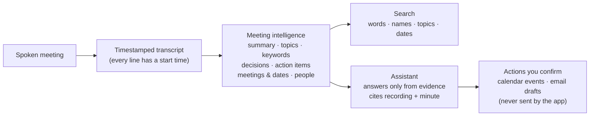

The principle behind every design decision: **trust over cleverness.**

- Every extracted item (task, meeting, person) is linked to the transcript segment it came from. Items without a valid link are thrown away.
- Every answer must cite segments. **The server**, not the prompt, verifies that each citation points to evidence it actually gave the model. Sources shown to the user are rebuilt from the database, never copied from model text.
- If nothing valid remains, the answer is a plain *"The recordings don't contain this."*
- Anything that changes the world is a **proposal** that a human confirms.

## 3. The two halves: hardware and software

The challenge has two tracks that meet at exactly one HTTP request. You are scored on your own half, so the contract has to be exact.

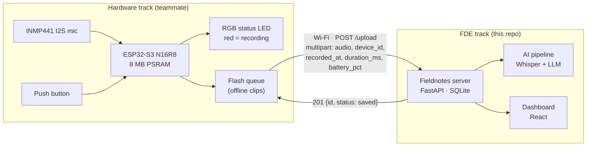

| | Hardware (teammate) | Software (me, this repository) |
|---|---|---|
| Responsibility | Capture clean audio, show state honestly, never lose a clip, send it in the agreed format | Accept clips, transcribe, understand, search, answer with sources, act with confirmation, update live |
| Ends / starts at | The audio file reaching `POST /upload` | The audio file arriving at `POST /upload` |
| Brief levels | L1 board alive · L2 clean audio · L3 status light · L4 upload · L5 no Wi-Fi no loss · L6 unplugged | L1 transcribe · L2 dashboard · L3 understand · L4 ask · L5 act · L6 honest & live |

**How I see the recorder:** a *simple, reliable, honest edge device.* It captures, shows its state truthfully (red light for the entire recording, always), keeps every clip until the server confirms it, and retries. All the intelligence lives on the server, so the firmware stays small and hard to break. The server is built so the device never has to be clever: duplicates are accepted with `201`, so retries are always safe (details in [Part IV](#part-iv-hardware-integration)).

## 4. What is built today

### Brief levels (FDE track)

| Level | "Done when" (brief) | Status | How it is met |
|---|---|---|---|
| **L1** Transcribe | Every recording has a transcript with segment timestamps, stored in a database with `recorded_at` and duration | ✅ | Groq Whisper large-v3 → `segments(start_s, end_s, text)` in SQLite; duration from the WAV or the client |
| **L2** Dashboard | List recordings by day, read the transcript, play the audio, search across all transcripts | ✅ | Recordings grouped by local day; waveform player with click-to-seek; FTS5 search with dates |
| **L3** Understand | Summary, action items (who / what / by when), meetings and dates mentioned, people | ✅ | Plus topics, keywords, key points, decisions; every item tied to its segment |
| **L4** Ask | Chat answers from the recordings; every answer names the recording and the time | ✅ | Source chips `Vendor call · 3 Nov 10:05 · at 00:12`, verified server-side |
| **L5** Act | Add a calendar event and draft a follow-up email, saved and never sent, confirming before acting | ✅ | Proposal → editable card → confirm. From chat, action items, recordings and calendar suggestions |
| **L6** Honest & live | Says when the recordings don't contain the answer; a new `POST /upload` appears within a minute without a restart | ✅ | Abstains without valid citations; live push over SSE, **measured 0.36 s** |

### Verified on real data

| Input | Result |
|---|---|
| Two spoken mock meetings (Windows TTS, 16 kHz WAV, ~35 s each) | Transcribed in **~1.1 s** each (measured by `manage.py check`), fully analysed |
| Two real phone call recordings (**MP3, 8 kHz, stereo**, 65 s and 214 s) | Converted to 16 kHz mono WAV and processed end to end |
| A real lift-installation call | Summary, address, site-visit date and cost discussion extracted; Ask answered with 6 timestamped sources |

### Feature map

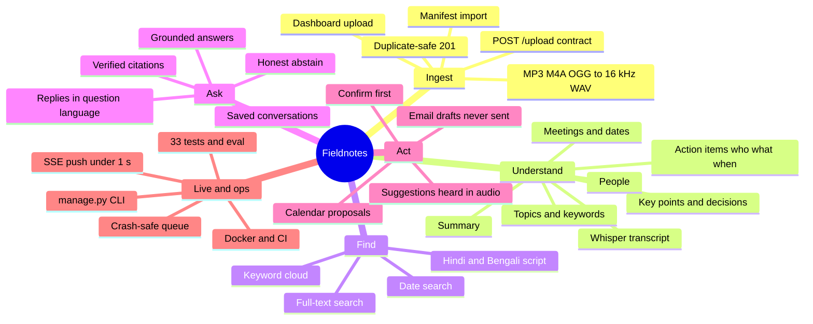

---

# Part II: Run it

## 5. Quick start (5 minutes)

### Requirements

| Need | Notes |
|---|---|
| **Python 3.10+** | Tested on 3.12, 3.13, 3.14. On Windows tick *"Add python.exe to PATH"* during install |
| **Git** | To clone the repo |
| **Groq API key** (free) | [console.groq.com/keys](https://console.groq.com/keys). Used for speech-to-text and, by default, the LLM |
| Node.js | **Not needed.** The dashboard is prebuilt in `frontend/dist` and served by the backend |
| ffmpeg | **Not needed.** Installed automatically via `imageio-ffmpeg` |

### Install and run

```bash
git clone https://github.com/0xjyotirmoy/Pocket_Recorder_FDE.git
cd Pocket_Recorder_FDE

python manage.py setup                  # creates backend/.venv, installs packages (safe to re-run)
python manage.py set-key gsk_your_key   # stored once in ~/.fieldnotes/config.env, outside the repo
python manage.py check                  # self-test, every line should be [ OK ]
python manage.py start                  # opens http://localhost:8000
```

On macOS/Linux use `python3` if `python` isn't Python 3. Press **Ctrl+C** to stop.

What `check` looks like on a working machine:

```
=== Fieldnotes self-check ===
[ OK ] Python 3.14.7
[ OK ] Python packages installed
[ OK ] GROQ_API_KEY set (gsk_...zq04)
[ OK ] Providers: speech=groq (whisper-large-v3), llm=openai/gpt-oss-120b
[ OK ] Data folder writable (C:\Users\you\.fieldnotes\data)
[ OK ] ffmpeg available (MP3/M4A/OGG uploads, large files)
[ OK ] Dashboard build present
[ OK ] manifest.json: 2 entries
[ OK ] Port 8000 is free
[ OK ] Groq key accepted
[ OK ] speech model available: whisper-large-v3
[ OK ] LLM model available: openai/gpt-oss-120b
[ OK ] Speech-to-text on rec_01_vendor_call.wav: 6 segments in 1.1s
        "Good morning Ravi, thanks for joining. This is Priya from Northwind. Morning Priya. Let's …"
[ OK ] LLM JSON call works (0.7s): {"status": "ok", "sum": 5}
All good. Run: python manage.py start
```

### First five minutes in the app

1. **Recordings → Import samples.** Two mock meetings (vendor call, team stand-up) go *Queued → Transcribing → Analysing → Ready*.
2. Open **Vendor call**: play the waveform, click a transcript line, read the summary and action items.
3. **Search** `nov 3`, then `priya`.
4. **Ask** *"What did we promise the vendor?"*, then *"What is the price per unit?"* (the honest "not in recordings" answer).
5. **Ask** *"Schedule the review call on 5 Nov at 3pm with Ravi"* → **Add to calendar**, then open **Calendar**.

### Send a clip exactly like the recorder does

```bash
curl -F "audio=@sample-recordings/rec_01_vendor_call.wav" \
     -F "device_id=rec-01" \
     -F "recorded_at=2026-11-05T14:32:10+05:30" \
     -F "duration_ms=" \
     -F "battery_pct=76" \
     http://localhost:8000/upload
# {"id":"rec-01_2026-11-05T14-32-10+05-30","status":"saved"}   HTTP 201
```

On Windows PowerShell use `curl.exe`. Run it again and you get the **same id and still one recording**: that's the duplicate protection the recorder relies on.

### Other ways to run

<details>
<summary><b>Without any API key (canned data, for exploring the UI)</b></summary>

```bash
# macOS / Linux
ASR_PROVIDER=fake LLM_PROVIDER=fake python manage.py start
# Windows PowerShell
$env:ASR_PROVIDER="fake"; $env:LLM_PROVIDER="fake"; python manage.py start
```
</details>

<details>
<summary><b>With Claude for answers and analysis</b></summary>

```bash
python manage.py set-key sk-ant-your_claude_key
python manage.py check
```
Answers, analysis and action planning switch to **Claude Sonnet 5.5**; speech-to-text stays on Groq Whisper (Claude doesn't accept audio). Remove `ANTHROPIC_API_KEY` from `~/.fieldnotes/config.env` to switch back.
</details>

<details>
<summary><b>Docker</b></summary>

```bash
echo "GROQ_API_KEY=gsk_your_key" > .env
docker compose up --build     # http://localhost:8000, data in the "fieldnotes-data" volume
```
The image builds the React app in a Node stage and runs FastAPI on Python 3.12-slim with a health check.
</details>

<details>
<summary><b>Frontend development (hot reload)</b></summary>

```bash
python manage.py start                         # API on :8000
cd frontend && npm install && npm run dev      # http://localhost:5173/app/ talks to :8000
npm run build                                  # rebuild frontend/dist after UI changes
```
</details>

### CLI reference

| Command | What it does |
|---|---|
| `python manage.py setup` | Create/repair `backend/.venv`, install requirements, move an old `./data` and a project `.env` key into `~/.fieldnotes`, create sample meetings on Windows |
| `python manage.py set-key <key>` | `gsk_...` → `GROQ_API_KEY`; `sk-ant-...` → `ANTHROPIC_API_KEY` (switches the LLM to Claude) |
| `python manage.py config` | Show where the keys and data live, and which LLM is active |
| `python manage.py check` | Self-test, including a real Groq transcription and a real LLM call |
| `python manage.py start [--port N] [--host H] [--no-browser]` | Run API + worker + dashboard |
| `python manage.py test` | 33 offline tests (fake providers) |
| `python manage.py eval [--server URL]` | Score golden questions against the running server |

## 6. Configuration

Settings are resolved **first non-empty value wins**:

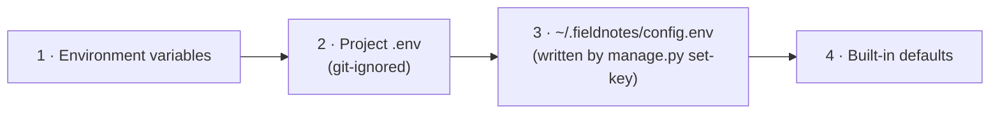

| Variable | Default | Meaning |
|---|---|---|
| `GROQ_API_KEY` | — | Required for speech-to-text and the default LLM |
| `ANTHROPIC_API_KEY` | — | If set, the LLM switches to Claude automatically |
| `ASR_PROVIDER` | `groq` | `groq` · `local` (faster-whisper) · `fake` |
| `GROQ_ASR_MODEL` | `whisper-large-v3` | Groq speech model |
| `ASR_LANGUAGE` | auto | Force `en`, `hi` or `bn` when all audio is one language |
| `ASR_FALLBACK` | — | `local` = use faster-whisper if Groq fails (`pip install -r backend/requirements-local.txt`) |
| `LLM_PROVIDER` | `openai_compat` (or `anthropic` if a Claude key exists) | `openai_compat` · `anthropic` · `fake` |
| `LLM_MODEL` | `openai/gpt-oss-120b` (Claude: `claude-sonnet-5-5`) | Model id |
| `LLM_BASE_URL` | `https://api.groq.com/openai/v1` | Any OpenAI-compatible endpoint |
| `APP_TIMEZONE` | `Asia/Kolkata` | Used for "today", "yesterday" and default event times |
| `DATA_DIR` | `~/.fieldnotes/data` | Database + audio location |
| `MAX_UPLOAD_MB` | `200` | Upload size limit |
| `FIELDNOTES_HOME` | `~/.fieldnotes` | Where `config.env` and data live |

## 7. Using the dashboard, page by page

The dashboard is served at **`http://localhost:8000/app/`**. It uses a "field logbook" design: paper and ink, one signal-red accent (the recorder's LED colour), serif headings, monospace timestamps, and **Day / Night / Auto** themes (switch at the bottom of the left menu, remembered per browser). Every list updates live.

<p>
  
  
</p>

| Page | What you see | What you can do |
|---|---|---|
| **Overview** `/app/` | Sessions · audio minutes · **from recorder** vs **upload/import** · open items · upcoming. A **keyword cloud** across all audio (size = number of sessions), topics, **sessions by date** with topic line, keyword chips, source (Recorder / Imported / Uploaded), device, duration, status. Open action items, "N meetings heard in recordings, not on your calendar", coming up, storage use and data path | Click a keyword → Search. Click a session → its recording page. Tick an item done. Jump to calendar suggestions |
| **Recordings** `/app/recordings` | All sessions grouped by day (in each recording's own timezone) | **Import samples** (manifest), **Upload audio** (WAV, MP3, M4A, OGG, AAC, WebM) |
| **Recording** `/app/recordings/:id` | Title, date/time, device, duration, language, battery, source. **Topics** and **keyword chips**. **Waveform player** decoded from the audio itself (180 bars; red = played) with **▲ markers** where a task or meeting was said. Timestamped transcript with the current line highlighted. Summary, key points, decisions, action items (said at mm:ss), meetings & dates (resolved dates plus the original words), people | Click the waveform, a ▲ marker or a transcript line to seek. `?t=SECONDS` deep links (used by every source chip). **Draft follow-up email**, **Re-analyse**, **Retry** (if failed), **Delete** |
| **Search** `/app/search` | **Sessions** matching a date or metadata (title, topics, keywords, people, summary) and **lines said in recordings** with highlighted matches | Type words, names, topics or dates: `nov 3`, `3/11`, `yesterday`, `last week`, `delivery 3 nov` |
| **Ask** `/app/ask` | Answers with **source chips**; grey **"Not in recordings"** box when there's no evidence (with the closest moments, if any); **saved conversations** on the right | Ask in English, हिन्दी or বাংলা. Say *"schedule…"*, *"remind me…"* or *"draft a mail to…"* to get a confirm card |
| **Action items** `/app/actions` | Commitments heard in recordings: who, what, by when (overdue in red), source recording and minute | Tick = done (moves to the **Done** tab, with **Undo**). **Draft email** or **Add to calendar** per item, both confirm-first |
| **Calendar** `/app/calendar` | **"Heard in recordings, not on your calendar yet"** (meetings and deadlines with dates), week grid with confirmed events and dashed suggestions, upcoming list | **Review & add** → edit → confirm. Delete events. Jump to the source recording |
| **Drafts** `/app/drafts` | Sessions without a follow-up yet, and all saved drafts (marked *never sent by Fieldnotes*) | **Draft follow-up**, **Edit**, **Copy**, **Open in email app** (fills your own mail client; you press send), **Delete** |

<p>
  
  
</p>

---

# Part III: How it works

## 8. Architecture

### 8.1 System context

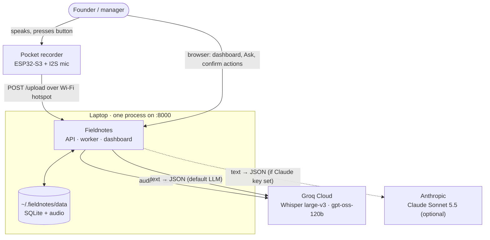

### 8.2 Components inside the server

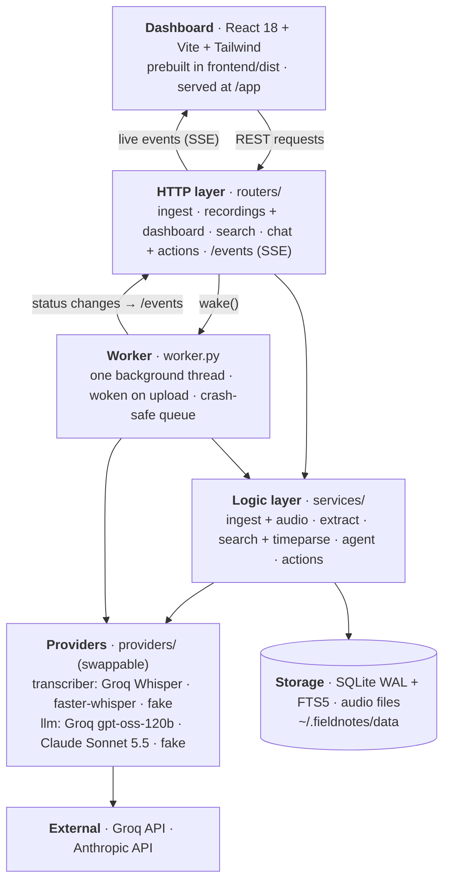

**Why a modular monolith:** one process (API + worker + static dashboard), one SQLite file, one port. Nothing else to install on a demo laptop, and the boundaries (routers → services → providers) let me swap the speech or LLM provider, or test with fakes, without touching the rest.

### 8.3 Deployment topology (build day)

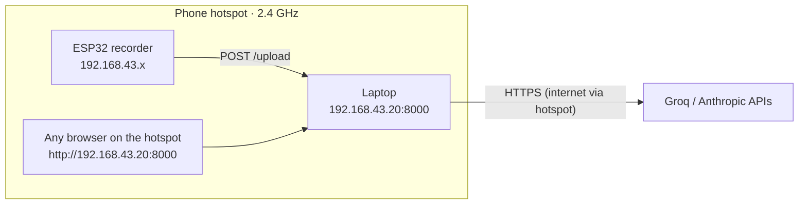

The laptop runs with `--host 0.0.0.0`, port 8000 is allowed through the Windows firewall, and the recorder is configured with the laptop's hotspot IP (`ipconfig`).

## 9. From the button press to the answer

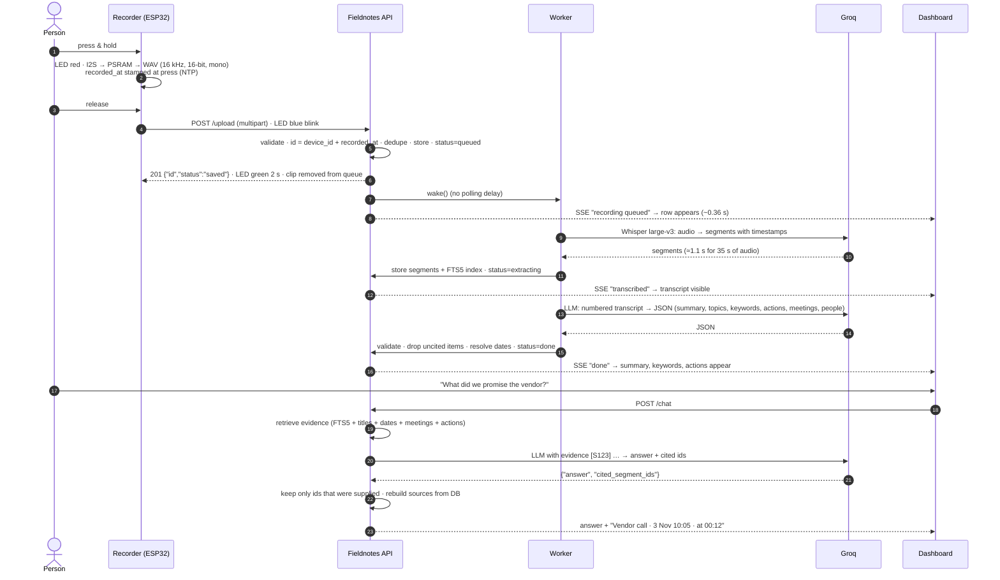

## 10. The processing pipeline

### 10.1 Recording lifecycle

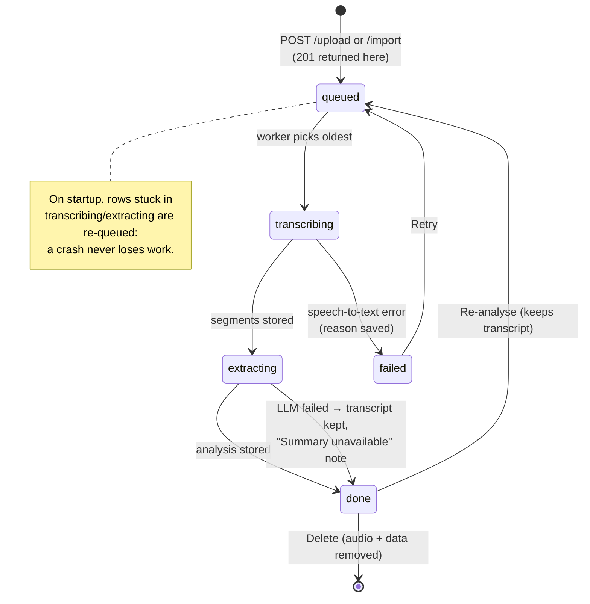

### 10.2 Step by step

| # | Step | Where | Details |
|---|---|---|---|
| 1 | **Receive** | `routers/ingest.py` | Streams the upload to a temp file in 1 MB chunks; 413 above `MAX_UPLOAD_MB` (200) |
| 2 | **Validate** | `services/ingest.py` | `device_id` required (≤ 64 chars); `recorded_at` must parse as ISO 8601 **with offset**; `duration_ms`, `battery_pct` optional (`battery_pct` 0–100, empty = null) |
| 3 | **Dedupe** | ingest | `id = device_id + "_" + recorded_at.replace(":", "-")`. If it exists → return it (the API still answers 201). Concurrent duplicates are caught by the primary key |
| 4 | **Normalise audio** | `services/audio.py` | RIFF/WAVE → stored as-is. Anything else (MP3, M4A, OGG, phone recordings) → **ffmpeg → 16 kHz mono 16-bit WAV**. Unreadable → 422 |
| 5 | **Store + signal** | DB, `events.py`, `worker.py` | Row `status=queued`, source = `device` / `import` / `dashboard`; SSE event; worker woken |
| 6 | **Transcribe** | `providers/transcriber.py` | Groq Whisper large-v3, `verbose_json`, segment timestamps, temperature 0. Files > 24 MB → FLAC; still too big → 600 s chunks with 5 s overlap, timestamps offset, overlap de-duplicated. Retries ×5 with back-off honouring `retry-after` |
| 7 | **Clean** | transcriber | Drops segments with `no_speech_prob > 0.6` **and** `avg_logprob < −1.0` (Whisper hallucinating in silence) |
| 8 | **Index** | `db.py` | Segments inserted in one transaction; SQLite triggers keep the FTS5 index in sync (`unicode61`, diacritics kept for Indic scripts) |
| 9 | **Analyse** | `services/extract.py` + `prompts/extract.md` | LLM gets `[S<id>] (mm:ss) text` lines + `recorded_at`; returns JSON. Up to 2 attempts if the JSON doesn't validate |
| 10 | **Validate + ground** | extract | Pydantic schema; items whose `segment_id` isn't in this recording are **dropped**; caps: 4 topics, 10 keywords, 12 key points/decisions; duplicate people removed |
| 11 | **Resolve dates** | `services/timeparse.py` | LLM date if valid, else a deterministic parser resolves "Thursday", "tomorrow", "12 Nov", "next week" against the clip's own `recorded_at` |
| 12 | **Done** | worker | Title set from the analysis; `status=done`; SSE event |

## 11. The AI layer: models, jobs, prompts, limits

### 11.1 Which AI does what

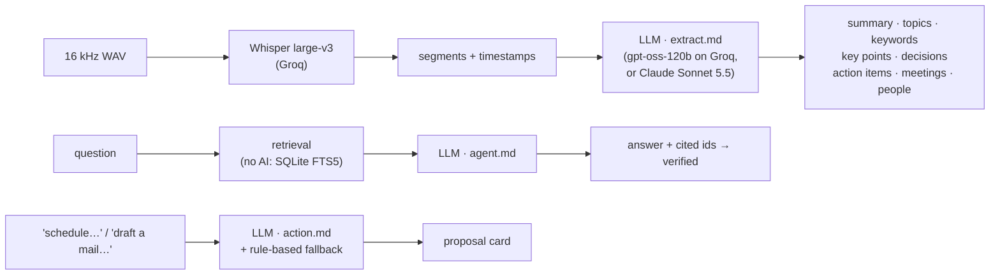

| Job | Model | Why this model | Its exact job here |
|---|---|---|---|
| **Speech → text** | **Whisper large-v3** via Groq API | The more accurate of Groq's two Whisper models (Groq lists 10.3% WER vs 12% for turbo); multilingual (English, Hindi, Bengali); returns segment timestamps; ~1 s for a 35 s clip; no GPU on the laptop | Produce `segments(start, end, text)` and the detected language for every clip |
| **Meeting analysis** | **gpt-oss-120b** via Groq (default) | Strong at structured JSON, reads Hindi/Bengali transcripts, very fast, free tier, same key as speech | Turn the numbered transcript into the JSON in 11.2, with a `segment_id` on every item |
| **Answering (Ask)** | same LLM | Reasoning over a small, numbered evidence set | Answer only from evidence, cite `[S id]`, state conflicts, reply in the question's language |
| **Action planning** | same LLM + deterministic fallback | Turns natural requests into a calendar event or an email draft | Always produce a proposal; guess sensibly (10:00 when no time is given, 30-minute events, recipients from people mentioned) and say what was guessed |
| **Follow-up emails** | same LLM over a template | A rule-based draft (summary + next steps) improved by the LLM | Short, factual follow-ups that use only facts from the recording |
| **Alternative LLM** | **Claude Sonnet 5.5** (`claude-sonnet-5-5`), native Messages API | Higher quality reasoning and multilingual writing when you have a key | Drop-in for all LLM jobs above via `manage.py set-key sk-ant-...` |
| **Offline speech (optional)** | **faster-whisper** (`small`) | No internet needed | Fallback when Groq fails (`ASR_FALLBACK=local`) or fully offline (`ASR_PROVIDER=local`) |
| **Tests** | Fake transcriber + fake LLM | Deterministic, offline CI | Exercise every code path, including LLM failure and hallucinated citations |

The `[S id]` citation scheme is the backbone: the transcript is shown to the model as `[S123] (00:12) We will send the purchase order by Thursday.`, so every claim the model makes can be checked against a real row with a real timestamp.

### 11.2 What the analysis returns (`prompts/extract.md`)

```json
{
  "title": "Vendor call",
  "summary": "Priya and Ravi confirmed an order of 200 sensor units …",
  "topics": ["Purchase order", "Delivery logistics"],
  "keywords": ["purchase order", "sensor units", "Salt Lake", "Kolkata", "Thursday"],
  "key_points": ["200 sensor units confirmed"],
  "decisions": ["Send the purchase order this week"],
  "action_items": [{"who": "Ravi", "what": "Send the purchase order", "due_text": "Thursday",
                    "due_date": "2026-11-05", "segment_id": 1042}],
  "meetings": [{"what": "Review call", "when_text": "the fifth of November at three p m",
                "when_iso": "2026-11-05T15:00", "segment_id": 1046}],
  "people": [{"name": "Priya", "role": "Northwind", "segment_id": 1040}]
}
```

Prompt rules: use only what is said; `who = "unassigned"` if nobody is named; resolve relative dates against `recorded_at`; output English even for Hindi/Bengali transcripts while keeping names as spoken; every item carries a `segment_id`.

### 11.3 The three prompts

| Prompt | Used by | Key rules |
|---|---|---|
| `prompts/extract.md` | worker, after transcription | Strict JSON schema above; ground every item in a segment; dates against `recorded_at` |
| `prompts/agent.md` | Ask (questions) | Answer **only** from EVIDENCE; every factual sentence ends with `[S id]`; say so if missing; state conflicting versions with both citations; never invent names, dates, quotes or timestamps; 1–3 sentences; reply in the question's language; transcript-relative dates are relative to that recording |
| `prompts/action.md` | Ask (requests to act) | Choose `create_calendar_event` or `draft_email` ("schedule mail" = email); **never refuse or ask back**, always propose and say what was guessed; ISO times with the NOW offset; default 10:00 and 30 min; recipients from people named; email body only from evidence; sign off "Best regards" |

### 11.4 Limits, and what the code does about each

| Limit | Impact | Handling in this repo |
|---|---|---|
| Groq free tier: **25 MB per file** | Long meetings rejected | > 24 MB → FLAC; still too big → 10-minute chunks with 5 s overlap, de-duplicated |
| Groq bills **≥ 10 s per request** | Very short clips cost 10 s of quota | Accepted; the recorder should avoid sub-second accidental clips |
| Free-tier **rate limits** (429) | Bursts fail | Retries with exponential back-off honouring `retry-after` (×5 speech, ×4 LLM) |
| Whisper picks **one language per file** | Heavily code-mixed audio may come out partly translated | `ASR_LANGUAGE=hi`/`bn` forces a language; summaries stay English; search works in native scripts |
| Whisper **hallucinates in silence** | Fake sentences in quiet parts | Low-confidence, high-no-speech segments dropped |
| LLM **malformed JSON** | Analysis fails | JSON mode where supported, tolerant extraction, schema validation, a second attempt; on final failure the transcript is kept and the reason is shown |
| LLM **invents citations** | Untrustworthy answers | Server keeps only ids it supplied; otherwise abstains |
| LLM **asks back instead of acting** | "Schedule mail" did nothing | Dedicated action prompt plus a rule-based fallback that always builds a card |
| **Claude Sonnet 5.5** rejects `temperature`/`top_p` | Every call would 400 | Not sent (regression-tested); adaptive thinking blocks are skipped when reading the answer |
| Claude has **no audio input** | Can't transcribe | Speech always stays on Whisper |
| Cloud APIs need **internet** | No processing offline | Clips are stored regardless; `ASR_FALLBACK=local` for offline speech |
| Audio leaves the laptop | Privacy | Fine for the brief's mock data; use local speech or an appropriate provider agreement for real meetings |

## 12. Ask: retrieval, grounding and citation checks

This is **retrieval-augmented generation without a vector database**: lexical retrieval plus structured metadata, then a server-side citation check.

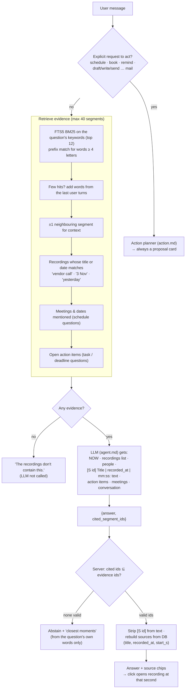

**Intent detection** separates a question from a request: *"What's on my schedule next week?"* and *"Who sent the email?"* are questions; *"schedule mail…"*, *"reminder on vendor payment"* and *"add the demo to my calendar"* are requests. All of these are covered by tests.

**Conversations** are stored server-side; follow-up questions use the last 8 messages of the same conversation, so *"and the delivery address?"* works after *"what did we promise the vendor?"*.

**Why lexical and not embeddings:**
- Meeting questions hinge on exact names, numbers, places and dates, where BM25 is precise and explainable.
- The corpus is small, and Groq offers no embedding endpoint.
- Grounding is enforced by the citation check either way. A hybrid embedding re-ranker can slot into `services/agent.py` without changing anything else.

## 13. Actions: calendar events and email drafts

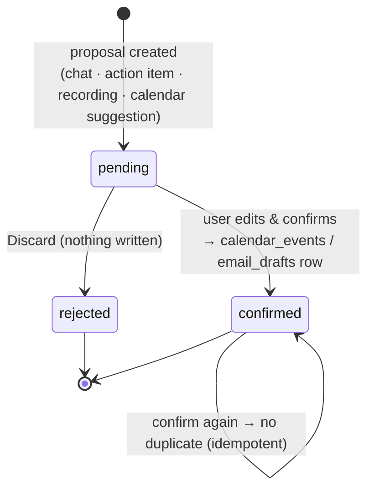

| Source of a proposal | Endpoint | What gets pre-filled |
|---|---|---|
| Ask: *"schedule…"*, *"draft a mail…"* | `POST /chat` | LLM plan (title, ISO start/end, attendees, or to/subject/body) |
| Action item: **Draft email** | `POST /action-items/{id}/email` | Follow-up about that commitment, addressed to its owner |
| Action item: **Add to calendar** | `POST /action-items/{id}/schedule` | Deadline at 10:00 on the due date (or tomorrow 10:00 if none) |
| Recording: **Draft follow-up email** | `POST /recordings/{id}/followup-email` | Summary + next steps of that meeting |
| Calendar: **Review & add** | `POST /calendar/suggestions/{ref}` | A meeting *heard in a recording* (`mention:<id>`) or a deadline (`item:<id>`), with attendees from the people mentioned |

Rules:
- Nothing is written before **Confirm**.
- An email needs a recipient at confirm time (it can be filled in the card).
- Calendar suggestions disappear once the linked event exists (`source_ref`).
- There is **no email-sending code** in the repository, and a test greps for `smtplib`, `sendmail` and `send_message(`. **Open in email app** uses a `mailto:` link, so the user sends from their own client.

## 14. Live updates and latency

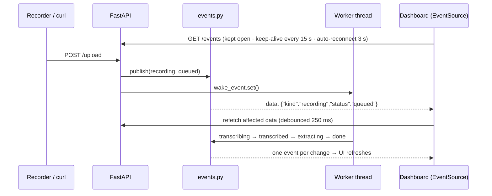

- The worker thread publishes into each subscriber's asyncio queue with `call_soon_threadsafe`, so there's no polling and no extra infrastructure.
- The UI keeps one shared `EventSource`; every data hook refetches on an event (debounced 250 ms), with slow polling as a fallback.

| Step | Time |
|---|---|
| Upload → visible on an open dashboard | **0.36 s** (measured, headless browser) |
| Whisper large-v3, 35 s clip | **~1.1 s** (measured) |
| LLM JSON round trip | **~0.7 s** small call (measured); full analysis typically a few seconds |
| Worker idle wake-up | immediate on upload (2 s safety poll otherwise) |
| Test suite (33 tests, fake providers) | ~3.5 s |

## 15. Search: words, names, topics and dates

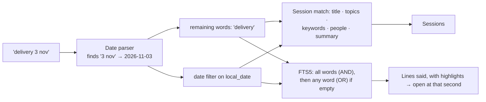

| You type | Understood as |
|---|---|
| `2026-11-03`, `3 Nov`, `Nov 3rd`, `3rd November`, `3/11` (day/month) | That date (year = the nearest one to today) |
| `today`, `yesterday`, `tomorrow` | Relative to `APP_TIMEZONE` |
| `last week`, `this week`, `next week` | Monday–Sunday range |
| `monday` … `sunday` | The most recent one (for searching past meetings) |
| `priya`, `purchase order`, `salt lake` | Sessions with that in their metadata + transcript lines |

- Search terms are tokenised so Hindi and Bengali words stay whole: Python's `\w` alone splits Indic words at every vowel sign, which silently broke search until it was fixed.
- Highlights are control characters converted to `<mark>` in the UI, so transcript text is never injected as HTML.

## 16. Data model, storage and sessions

### 16.1 Where things live

| What | Location |
|---|---|
| Keys and settings | `~/.fieldnotes/config.env` (Windows `C:\Users\<you>\.fieldnotes\config.env`) |
| Database | `~/.fieldnotes/data/app.db` (SQLite, WAL mode, foreign keys on) |
| Audio | `~/.fieldnotes/data/audio/<id>.wav` |

Keys and data live **outside the repository**, so pulling an update or re-cloning never loses recordings and never asks for the key again. Schema changes are **additive migrations run automatically at start**, so old databases keep working.

### 16.2 Entity relationships

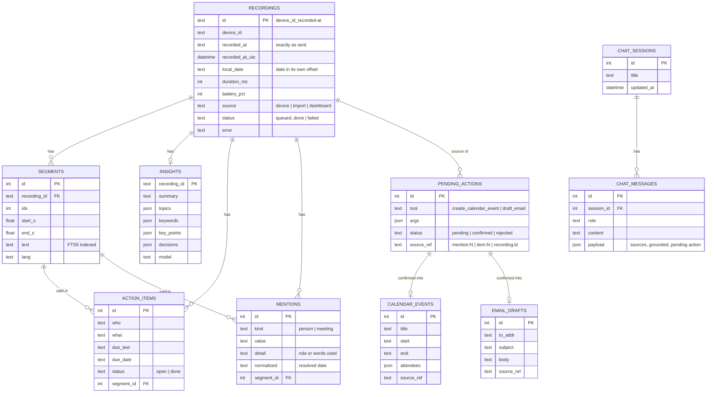

### 16.3 Sessions

- **Recording sessions:** each clip is a session, identified by `device_id + recorded_at`. `recorded_at` is stored **exactly as sent**, plus a UTC copy for sorting and a **local date in the clip's own offset** for grouping, so a 00:30 IST clip doesn't land on the previous day.
- **Chat sessions:** created on the first question, listed (latest 50) on the Ask page, deletable. Assistant turns store their sources and proposal, and reopening a conversation refreshes proposal status (confirmed/rejected).
- **Storage management:** the Overview shows audio and database size and the data path; deleting a recording removes its segments, analysis, mentions, action items and the audio file.

## 17. API reference

Interactive docs: **`http://localhost:8000/docs`** (OpenAPI).

| Method | Path | Purpose |
|---|---|---|
| `POST` | `/upload` | **Hand-off contract** ([§18](#18-the-hand-off-contract)) |
| `POST` | `/import` | Import `sample-recordings/manifest.json` → `{imported, skipped, errors}` |
| `GET` | `/health` | `{ok, db, worker_alive, queue_depth, processing, asr, llm}` |
| `GET` | `/events` | Server-Sent Events stream |
| `GET` | `/dashboard` | Totals by source, keywords (top 24), topics (top 12), sessions by day, open items, upcoming, storage |
| `GET` | `/recordings?date=YYYY-MM-DD` | Sessions (newest first) with topics, keywords, summary |
| `GET` / `DELETE` | `/recordings/{id}` | Full detail (segments, insights, actions, meetings, people) / delete everything incl. audio |
| `GET` | `/recordings/{id}/audio` | WAV, range requests supported (seeking) |
| `POST` | `/recordings/{id}/retry` · `/reextract` | Re-run all · re-analyse only |
| `POST` | `/recordings/{id}/followup-email` | Proposal: follow-up draft |
| `GET` | `/search?q=&date_from=&date_to=` | `{date_from, date_to, text, recordings[], hits[]}` |
| `GET` / `PATCH` | `/action-items?status=` · `/action-items/{id}` | List · `{status: open\|done}` |
| `POST` | `/action-items/{id}/email` · `/schedule` | Proposals from a commitment |
| `POST` | `/chat` | `{message, session_id?}` → `{answer, grounded, sources[], related[], pending_action, session_id}` |
| `GET` / `DELETE` | `/chat/sessions` · `/chat/sessions/{id}` | Conversations |
| `GET` / `POST` | `/calendar/suggestions` · `/calendar/suggestions/{ref}` | Heard-in-recordings suggestions · make a proposal |
| `POST` | `/actions/{id}/confirm` (`{args?}`) · `/actions/{id}/reject` | Confirm (idempotent, optional edits) · discard |
| `GET` / `DELETE` | `/calendar` · `/calendar/{id}` | Events |
| `GET` / `PATCH` / `DELETE` | `/drafts` · `/drafts/{id}` | Drafts (never sent) |

Example: a grounded answer

```http
POST /chat
{"message": "What did we promise the vendor?"}

200 OK
{
  "answer": "To send the purchase order by Thursday and confirm the delivery address before Friday.",
  "grounded": true,
  "sources": [{"segment_id": 1042, "recording_id": "rec-demo_2026-11-03T10-05-00+05-30",
               "title": "Vendor call", "recorded_at": "2026-11-03T10:05:00+05:30", "start_s": 12.0,
               "text": "Yes. We will send the purchase order by Thursday."}],
  "related": [], "pending_action": null, "session_id": 7
}
```

Errors are JSON `{"error": "..."}` with the right status: 400, 404, 409 (busy/discarded), 413, 422, 503 (LLM unavailable).

---

# Part IV: Hardware integration

## 18. The hand-off contract

From the challenge brief. Both tracks must match it exactly.

**`POST /upload`** · `multipart/form-data`

| Field | Type | Example | Rules |
|---|---|---|---|
| `audio` | file | `clip.wav` | WAV, **16,000 Hz, 16-bit PCM, mono**. 30 s ≈ 960 KB |
| `device_id` | text | `rec-01` | Fixed per device, ≤ 64 chars |
| `recorded_at` | text | `2026-11-05T14:32:10+05:30` | When recording **started**, ISO 8601 **with offset**, from NTP, correct to the second |
| `duration_ms` | number | `8200` | Clip length; may be empty (the server measures it) |
| `battery_pct` | number | `76` | 0–100; **empty on USB power** |

| Response | Meaning | Recorder action |
|---|---|---|
| **`201 {"id": "rec-01_2026-11-05T14-32-10+05-30", "status": "saved"}`** | Saved, **or already saved before** | Delete from queue · LED green 2 s |
| `400 {"error": "missing 'audio' file"}` | No audio part | Keep the clip; firmware bug |
| `422 {"error": "..."}` | Bad `recorded_at` (no offset) or unreadable audio | Keep the clip; fix firmware |
| `413` | Too large | Never for ≤ 30 s clips |
| 5xx / timeout / no network | Server or network down | Keep the clip, back off, retry |

**Why duplicates return 201:** the brief says anything other than 201 means "keep the clip and retry". If the server answered a duplicate with 200 or 409, a recorder whose first 201 got lost would retry **forever**. Returning 201 with the same id makes retries safe and keeps the brief's hardware L5 ("none are sent twice") true even on bad Wi-Fi.

> The brief's example id is `rec-01_2026-11-05T14-32-10`, but its own reference receiver builds the name from the full `recorded_at`, offset included. This server does the same. The recorder only needs to check for the 201.

## 19. Integration flows and failure handling

### 19.1 Normal, offline and lost-reply cases

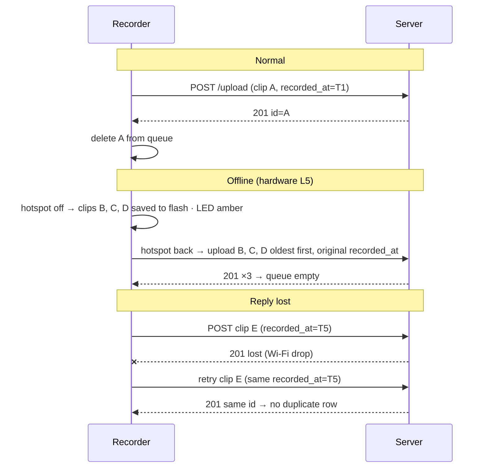

### 19.2 Recorder state machine (as specified in the brief)

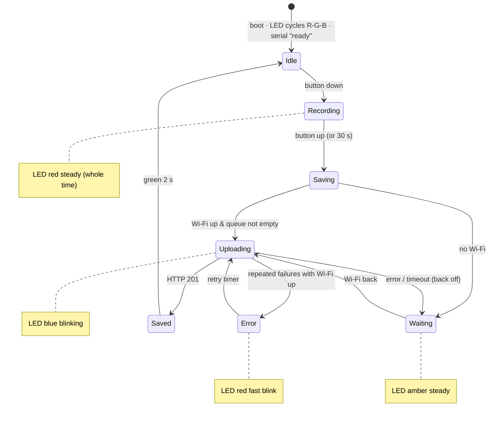

### 19.3 What each LED state means to the server

| LED | Device state | Server-side meaning |
|---|---|---|
| Off | Idle | — |
| **Red steady** | Recording | Nothing yet (the clip lives on the device) |
| Blue blinking | Uploading | `POST /upload` in flight |
| Green 2 s | Saved | Server returned **201**; row created (or already existed) |
| Amber steady | Clips waiting for Wi-Fi | Server has not seen them yet |
| Red fast blink | Error | Mic missing, or uploads failing with Wi-Fi up (server down / wrong IP / firewall) |

### 19.4 Joint test plan (build day)

| # | Test | Pass when |
|---|---|---|
| 1 | Phone browser on the hotspot → `http://<laptop-ip>:8000/health` | `"ok": true` |
| 2 | Reference curl from another machine | 201 · clip on the dashboard in ~1 s |
| 3 | Recorder: press, speak 10 s, release | Red → blue → green · clip appears · time = press time to the second |
| 4 | Audio quality | Normal speed, no hiss or clipping, waveform not flat |
| 5 | Duplicate | Re-send the same clip → 201 same id, one row |
| 6 | Offline (hardware L5) | 3 clips with the hotspot off → all arrive with their original times, no duplicates |
| 7 | Server down | Clips kept on the device → arrive after restart |
| 8 | Battery (hardware L6) | `battery_pct` shown on the recording page; empty on USB |
| 9 | **Bonus** | Ask a question about the device clip → answer cites it with the minute |

The full guide for the hardware developer is in [`docs/DOCUMENTATION.md`](docs/DOCUMENTATION.md): WAV header byte layout, INMP441 24→16-bit conversion, NTP, the exact multipart body, an ESP32 upload sketch, the offline queue algorithm, hotspot/firewall setup and troubleshooting.

## 20. My plan for the recorder firmware

My teammate owns the firmware. This is how I would structure it, and what the server already supports.

### 20.1 Task layout on the dual-core ESP32-S3 (FreeRTOS)

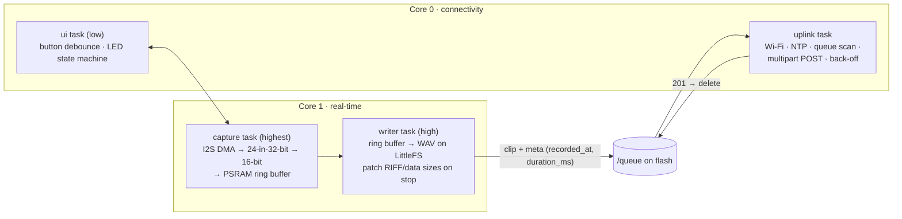

### 20.2 Rules I'd hold the firmware to

1. **Red LED for the entire recording**, driven by the same signal that gates the mic. No hidden recording mode.
2. **Stamp `recorded_at` at button press** from NTP-synced time, store it next to the clip, and **reuse it for every retry**.
3. **Never delete a clip before a 201.** Upload oldest first. Back off 2 s → 4 s → … → 60 s.
4. **Recording always wins:** capture and upload run in separate tasks on separate cores, so Wi-Fi never causes dropped audio.
5. **No fake dates:** if time was never synced since boot, refuse to record (error blink) or stamp after the first sync. Never send 1970.
6. **Secrets out of git:** Wi-Fi password and server IP in a git-ignored `secrets.h`. The laptop IP changes between hotspots, so make it configurable.

### 20.3 What I'd add next (the server will meet it halfway)

| Idea | Device side | Server side |
|---|---|---|
| **Streaming / chunked upload** for long meetings | 30 s parts with a session id | Stitch parts into one session; transcript grows during the meeting |
| **Voice activity detection** | Skip silence before upload | Smaller uploads, lower API cost |
| **Device auth** | Per-device token header, HTTPS | Reject unknown devices; today it's an open endpoint on a private hotspot |
| **Heartbeat** | Battery, queue length, firmware version, RSSI every N minutes | `/devices` endpoint + device page on the dashboard |
| **OTA + power profile** | Firmware updates over Wi-Fi; measured idle/recording/uploading mA | Battery-life estimate per device |

---

# Part V: Engineering

## 21. Tech stack and why

| Layer | Technology | Why this, not something else |
|---|---|---|
| API | **FastAPI** + Uvicorn | Streaming multipart uploads, typed validation, free OpenAPI docs |
| Database | **SQLite (WAL)** + **FTS5** via SQLAlchemy 2 | One file, zero setup, built-in full-text search with BM25; WAL lets the API read while the worker writes |
| Job queue | `recordings.status` + one worker thread | No Redis/Celery to install; crash-safe because interrupted jobs are re-queued at start |
| Live updates | **Server-Sent Events** | One-way push is all the UI needs; simpler than WebSockets; auto-reconnect built in |
| Speech | **Groq Whisper large-v3** | Accuracy + speed + timestamps + multilingual, without a GPU |
| LLM | **Groq gpt-oss-120b** / **Claude Sonnet 5.5** | Free and fast by default; higher-quality option with one command |
| Audio | `wave`, **ffmpeg via imageio-ffmpeg** | Real-world formats with no manual installs on Windows |
| Frontend | **React 18 · Vite 6 · Tailwind CSS 4 · React Router** | Fast iteration; the production build is served by FastAPI at `/app` (one port) |
| Design | Newsreader · Inter · JetBrains Mono · Noto Sans Bengali/Devanagari | Editorial and readable; Indic scripts render properly |
| Tooling | `manage.py`, pytest, eval harness, GitHub Actions, Docker | Same commands on Windows, macOS and Linux; CI on every push |
| Hardware | ESP32-S3 N16R8 · INMP441 · RGB LED · button | Given kit (hardware track) |

## 22. Reliability, error handling and security

| Situation | Behaviour |
|---|---|
| Bad upload (no audio, bad time, not audio) | 400/422 with a readable reason; nothing stored |
| Duplicate upload | 201 with the same id; not stored or processed again |
| Two identical uploads at the same instant | Primary key conflict caught → returns the existing row |
| Speech-to-text fails | `status=failed`, reason shown, **Retry** button; worker keeps running |
| LLM fails | Transcript kept, `done` with "Summary unavailable: …", **Re-analyse** later |
| LLM unavailable during Ask | HTTP 503 with a clear message |
| Server killed mid-processing | On restart, `transcribing`/`extracting` rows go back to `queued` |
| Search input with quotes or FTS operators | Tokens are quoted, so `"`, `NEAR(`, `'; DROP TABLE` are harmless (tested) |
| Transcript text containing HTML | Rendered as text; highlights use control characters, not HTML |
| Path traversal in a manifest | Files must resolve inside `sample-recordings/` |
| Keys | Outside the repo (`~/.fieldnotes/config.env`, `chmod 600` where supported) or a git-ignored `.env`; `check` shows only the last 4 characters |
| Email | Never sent by the app; drafts only |
| Network exposure | Binds `0.0.0.0` for the recorder on a private hotspot; no auth yet (see roadmap) |

## 23. Testing and evaluation

**`python manage.py test`: 33 tests**, offline (fake providers), ~3.5 s, run by GitHub Actions on every push together with a frontend build.

| Area | What is tested |
|---|---|
| Contract | 201 body shape; duplicate → 201 same id, one row; missing audio 400; bad/no-offset `recorded_at` 422; non-audio 422; local date in the clip's own offset |
| Ingest | Manifest import idempotent with error reporting; MP3 8 kHz stereo → converted, duration correct; garbage file rejected |
| Pipeline | Worker → done; hallucinated extraction item dropped; "Thursday" → correct date; transcription failure isolated; LLM failure keeps the transcript |
| Search | Timestamped hits; hostile FTS input; date queries (`nov 9`, `9 Nov`, `9/11`, ISO) return sessions; mixed date + words; keyword metadata match; Hindi and Bengali script |
| Ask | Valid citation with the exact `start_s`; hallucinated id → abstain; no evidence → abstain without calling the LLM; *"what's on my schedule"* is not an action |
| Actions | Nothing written before confirm; double confirm writes once; reject writes nothing; model refuses → fallback card (email and 4 pm reminder); recipient required at confirm; suggestions → event removes the suggestion; email/schedule from action items |
| Sessions & storage | Conversations persist and reload; delete removes the audio file; old databases migrate |
| Providers | Claude request contains no `temperature`/`top_p`; thinking blocks skipped |
| Safety | No `smtplib` / `sendmail` anywhere in the code |

**`python manage.py eval`** runs 12 golden questions (`scripts/golden_qa.json`) against the live server with real models: answerable, unanswerable (*price per unit*, *who is the CEO*, *hiring decision*) and action requests. Each is scored on grounded vs abstain, expected words, cited recording and tool type. Edit the file for build-day recordings.

**`python manage.py check`** makes a real Groq transcription and a real LLM call and prints a fix for every failure.

## 24. Project structure

```
fieldnotes/
├── manage.py                     # CLI: setup · set-key · config · check · start · test · eval
├── backend/
│   ├── app/
│   │   ├── main.py               # FastAPI app · error handlers · /health · /events (SSE) · serves /app
│   │   ├── config.py             # env > project .env > ~/.fieldnotes/config.env > defaults
│   │   ├── db.py                 # engine (WAL, FKs) · FTS5 table + triggers · additive migrations
│   │   ├── models.py             # 10 tables (see ER diagram)
│   │   ├── worker.py             # background thread · wake on upload · crash recovery
│   │   ├── events.py             # thread-safe pub/sub → SSE
│   │   ├── doctor.py             # self-check behind `manage.py check`
│   │   ├── routers/              # ingest · recordings (+dashboard, action items) · search · chat (+actions, calendar, drafts)
│   │   ├── services/
│   │   │   ├── ingest.py         # validate · id · dedupe · store
│   │   │   ├── audio.py          # WAV checks · ffmpeg (bundled) · 16 kHz conversion
│   │   │   ├── extract.py        # analysis prompt · schema · grounding · dates
│   │   │   ├── search.py         # FTS5 queries · Indic tokenising · date-aware search
│   │   │   ├── agent.py          # retrieval · answer · citation check · intent · action planner
│   │   │   ├── actions.py        # proposals · confirm/reject · calendar suggestions · email template
│   │   │   ├── timeparse.py      # ISO parsing · relative dates · query date ranges
│   │   │   └── serialize.py      # API shapes
│   │   ├── providers/
│   │   │   ├── transcriber.py    # Groq Whisper (chunking, retries, silence filter) · faster-whisper · fake
│   │   │   └── llm.py            # OpenAI-compatible (Groq) · Claude Messages API · fake
│   │   └── prompts/              # extract.md · agent.md · action.md
│   ├── tests/                    # conftest (isolated data, fake providers) · test_api.py (33 tests)
│   ├── requirements.txt          # + requirements-local.txt (faster-whisper, optional)
├── frontend/
│   ├── src/
│   │   ├── App.jsx               # layout · navigation · live status · theme toggle
│   │   ├── lib.js                # API client · SSE live hook · theme · waveform decoder · formatters
│   │   ├── components.jsx        # status pills · source chips · snippets · empty/error states
│   │   ├── ActionCard.jsx        # editable confirm card · ProposeButton
│   │   └── pages/                # Today (Overview) · Recordings · Recording · Search · Ask · ActionItems · Calendar · Drafts
│   └── dist/                     # prebuilt dashboard (committed; served by the backend)
├── sample-recordings/            # manifest.json + two synthetic meetings (Windows TTS)
├── scripts/                      # eval_qa.py · golden_qa.json · make_samples.ps1 · smoke.sh / smoke.ps1
├── docs/
│   ├── DOCUMENTATION.md          # full specification + hardware developer guide
│   └── screenshots/
├── .github/workflows/ci.yml      # backend tests + frontend build
├── Dockerfile · docker-compose.yml
└── .env.example · .gitignore · LICENSE
```

## 25. How I built it

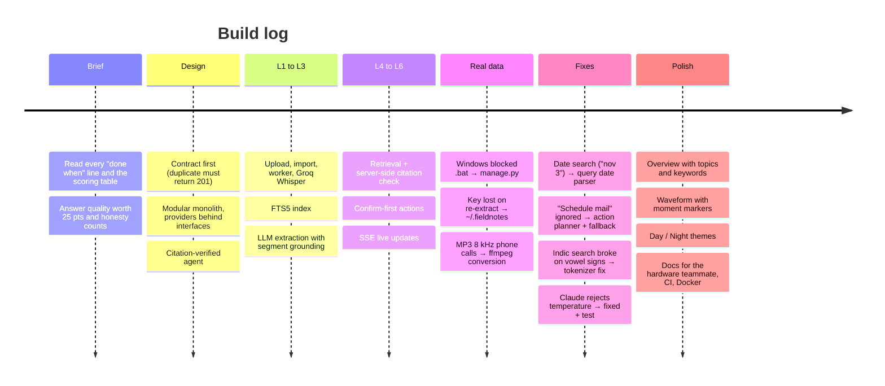

1. **Read the brief like a specification.** I listed every "done when" line for L1–L6 and the scoring table. *Answers to our questions: correct, sourced, honest when unknown* is worth 25 points, as much as most features combined.
2. **Contract first.** Before any UI I fixed the upload contract, including the detail that a duplicate must return 201.
3. **Architecture on paper:** routers → services → providers, fakes for tests, citations checked in code.
4. **Level by level**, each ending with tests and a curl against the real server, never moving on with a shaky level.
5. **Real-world debugging** on my Windows laptop with real phone recordings, which surfaced most of the important fixes.
6. **Design pass** to avoid the generic AI-dashboard look.
7. **Documentation for my teammate**, so the hardware side can build against the server without me in the room.

**AI-assisted development:** the challenge allows AI coding tools, and I used them as a pair programmer: Claude for architecture, code, reviews and debugging, plus Google's Antigravity IDE. The decisions, the testing against real hardware and audio, and the responsibility for every line are mine, and I can explain any part of this repository.

## 26. What I learned

- **Integrations fail at the contract.** One status code (201 vs 200 for a duplicate) decides whether a device retries forever. Idempotency keys (`device_id + recorded_at`) make retries safe *by design*, not by luck.
- **Make the AI accountable in code, not in the prompt.** The prompt asks the model to cite; the guarantee comes from the server rejecting any citation it never supplied. That single check turns "the AI said so" into "here is the minute it was said".
- **"I don't know" is a feature.** Getting the system to abstain cleanly was harder, and more valuable, than getting it to answer.
- **Real data breaks assumptions.** My samples were clean 16 kHz WAV; my first real recordings were 8 kHz stereo MP3 phone calls. Test with real inputs early.
- **Time is subtle.** Keep the original timestamp exactly, group by the date in its *own* offset, and resolve "Thursday" against when it was *said*, not when it is read.
- **Multilingual is more than the model.** Whisper handled Hindi and Bengali; my own tokenizer broke on Indic vowel signs. The bug was in the boring layer.
- **Latency is architecture, not hardware.** Waking the worker on upload and pushing over SSE took the dashboard from "refresh every few seconds" to 0.36 s, with zero extra infrastructure.
- **Developer experience decides whether anyone can run it.** SmartScreen, execution policies, BOM-prefixed JSON from PowerShell, keys lost on every re-extract: each small, together decisive. One `manage.py` with a `check` command fixed most of it.
- **Boring technology goes far.** SQLite + FTS5 + one thread delivered every requirement, with crash recovery, and nothing extra to install.
- **Scope discipline.** The brief says *"a working Level 4 you can explain beats a shaky Level 6"*. Finishing each level properly kept the whole system explainable.
- **AI tools are only as good as the specification and the verification.** They made me faster; the value came from precise requirements, testing everything against the real server, and pushing back on generic or wrong output.

## 27. Limits and roadmap

**Current limits**
- No speaker diarization: "who" comes from what is said, not from voice.
- Whisper decides one language per file; heavily code-mixed audio can be partly translated.
- Speech and LLM need internet (an offline speech fallback is available).
- One worker processes clips in order, which is fine for one recorder.
- No authentication on `/upload` yet (designed for a private hotspot).
- Calendar and drafts are internal by design; the brief requires drafts that are never sent.

**Roadmap**

| Next | Why |
|---|---|
| Speaker diarization (pyannote community-1) + voice enrollment | "What did the CEO say on 3 Nov?" |
| Indic speech-to-text for code-mixed segments (AI4Bharat IndicConformer / Sarvam) | Better Hindi/Bengali accuracy |
| Minutes-of-Meeting export (Markdown / Word / PDF), per-person briefings | Shareable outputs |
| Groq vs Claude comparison per language with `manage.py eval` | Pick the best default with evidence |
| Device fleet page, per-device tokens, streaming upload | Production-grade hardware integration |
| Optional calendar/email account sync, still confirm-first | Real-world workflows |

## 28. Troubleshooting and FAQ

| Symptom | Fix |
|---|---|
| `check` says `GROQ_API_KEY is not set` | `python manage.py set-key gsk_...` |
| Recording shows **Failed** with 401 | Key invalid/expired → new key → `set-key` → **Retry** |
| "Summary unavailable" but the transcript is fine | LLM problem (rate limit / network) → **Re-analyse** later; `check` shows the cause |
| Windows won't run scripts | Use `python manage.py ...`; there are no `.bat` files to unblock |
| `python` opens the Microsoft Store | Install Python from python.org with *Add to PATH*, or use `py manage.py ...` |
| Port 8000 busy | `python manage.py start --port 8010` |
| Recorder can't connect | Same **2.4 GHz** hotspot, firewall rule for TCP 8000, correct laptop IP from `ipconfig` |
| 422 `recorded_at must be ISO 8601 with a time zone offset` | Append `+05:30`; sync NTP before recording |
| Voice too fast/slow | WAV header must say 16000 Hz, 1 channel, 16-bit |
| Same clip twice | The recorder regenerated `recorded_at` on retry; store it with the clip |

**FAQ**

- **Does it send emails?** No. Drafts only; *Open in email app* lets you send from your own client.
- **Is there a vector database?** No. Lexical RAG (FTS5/BM25) plus metadata, with a server-side citation check ([§12](#12-ask-retrieval-grounding-and-citation-checks)).
- **Can it run fully offline?** Storage, search and the UI yes; speech can use faster-whisper; the LLM needs an endpoint (any OpenAI-compatible server via `LLM_BASE_URL`).
- **Where is my data?** `~/.fieldnotes/data` (shown on the Overview and by `manage.py config`).
- **Can I use Claude?** Yes: `python manage.py set-key sk-ant-...` (speech stays on Whisper).

## 29. Credits and license

| | |
|---|---|
| **Jyotirmoy Karmakar (JK)** | FDE track: architecture, backend, AI pipeline, dashboard, documentation · GitHub [@0xjyotirmoy](https://github.com/0xjyotirmoy) |
| **Hardware track** | **Kabyik Paul**: ESP32-S3 recorder firmware and build |
| Challenge | Vyohm AI · Pocket Recorder Challenge brief and hand-off contract |
| Sample audio | Synthetic role-plays generated with Windows text-to-speech; no real people |


